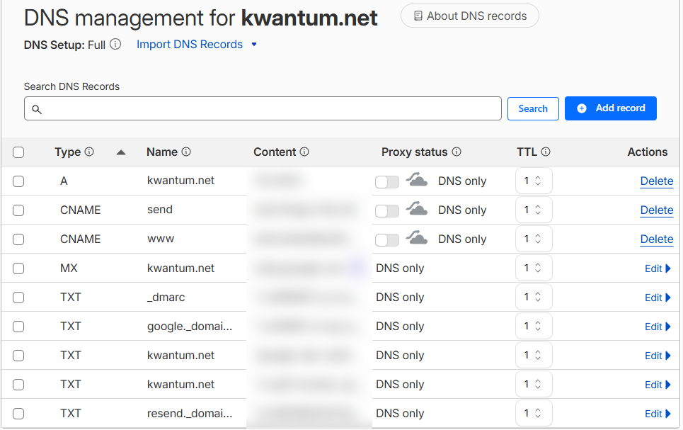
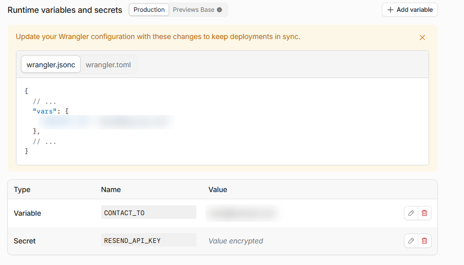
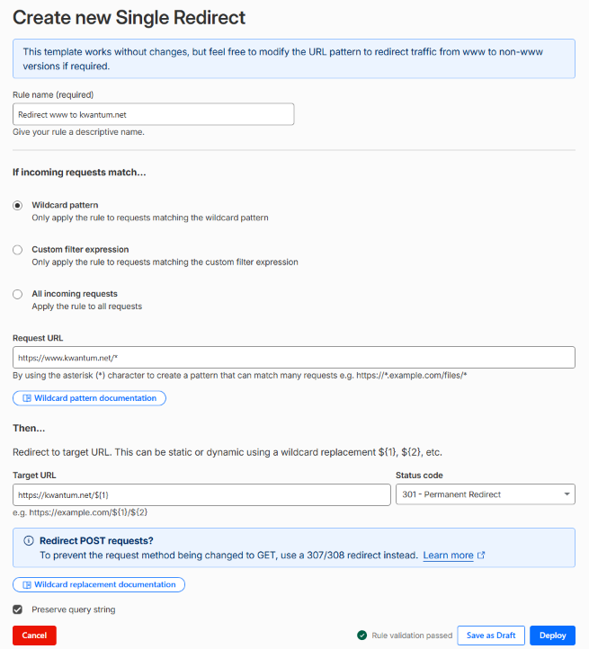

Most local business owners never think about where their website is hosted. That's fair: if it
loads and the phone rings, the hosting is doing its job. But your host's limits decide how often
you can update your site and whether it stays online when you do. I found that out with my own
site this month, so I moved it. This post covers why, how I did it without losing a single email or
enquiry, and what it means if you run a local business.

## The problem: my free plan rationed my updates

Kwantum's website was hosted on Netlify's free plan. Netlify now runs its plans on monthly credits.
At the time of writing, the free plan includes 300 credits a month, and every time you publish an
update to your live site it uses 15 of them. That works out to about 20 updates a month, before any
credits are spent on visitors loading your pages.

Twenty sounds like plenty until you're actively working on your site. In the month before I moved,
I published 17 updates: new suburb pages, reworked blog posts, title and description changes for
Melbourne searches. That had already used most of my credits. Netlify's pricing page says that when
a free-plan site runs out of credits, it's paused until the next billing cycle. In other words, the
site stops showing to visitors.

For a business that gets its enquiries through its website, that's not a risk worth taking.

## Why I chose Cloudflare

Cloudflare's free plan works differently. Serving pages to visitors costs nothing, and publishing
updates uses build minutes from a monthly allowance of 3,000. My site takes about a minute to
build, so I can publish more than a thousand updates a month. If I ever went over, my updates would
slow down, but the site would stay online.

Two other things mattered to me:

- **Speed.** When I tested the site after the move, Melbourne visitors were being served from
  Cloudflare's data centre in Melbourne. A fast site is better for the people visiting it, and page
  experience is something Google takes into account.
- **Room to grow.** I also build and look after websites for clients. With Cloudflare, each client
  can have their own free account, so their site and domain belong to them and their usage never
  counts against anyone else's.

## The part most people get wrong: it's not the website, it's the email

Moving the website itself was the easy bit. The real risk was everything else attached to the
domain.

Your domain has a settings list called DNS, which works like an address book for the internet. It
tells browsers where your website lives, and it also tells other mail servers where to deliver
email for your business. It includes records that prove the emails you send are really from you. When
you move to a new DNS provider, only what's in the new address book counts. Anything you forget to
copy across simply stops existing.

Here's what I checked before switching:

- **Email delivery records.** These tell the world your email is handled by Google Workspace. If
  they're missed, emails sent to you bounce.
- **Email signature records** (called SPF, DKIM and DMARC). These prove your emails are genuine. If
  they're missed, your emails to customers start landing in spam.
- **A security setting called DNSSEC.** It was switched on for my domain. If I'd changed providers
  without switching it off first and waiting a few hours, many internet providers would have
  treated my domain as broken. The website *and* email would have stopped working for a lot of
  people.

I made a full list of every record before starting, and after the switch I compared them one by
one, down to the last character of the long signature keys. Email kept working the whole time.

*The records I checked before switching over. The MX and TXT rows are what keep email working; values blurred.*

## Don't forget your contact form

Many hosts have their own built-in tools, and your website can quietly depend on them. My contact
form used Netlify's built-in form handling, which doesn't exist on Cloudflare. If I'd just moved
the site, the form would have looked fine but sent enquiries nowhere.

So I replaced it with a small piece of code that runs on Cloudflare and emails each enquiry
straight to my inbox, with the reply address set to the customer's email so I can respond in one
click. Then I tested it end to end on the live site to make sure a real enquiry arrived.

*Where the form gets its settings: the inbox enquiries go to, and the encrypted key for the email service.*

If you take one thing from this post, let it be this: **after any website change, send yourself a
test enquiry through your own contact form.** A broken form doesn't show up as an error anywhere.
You just stop getting leads.

## Keeping Google happy during the move

Google doesn't care which company hosts your site, but it does notice if pages disappear or the
site goes offline. To keep things smooth, I:

- kept every page at exactly the same address
- set up permanent redirects, so `www.kwantum.net` and the old `http://` version both point to
  `https://kwantum.net`, keeping the page and any tracking tags
- kept the site live on the old host until the new one was ready, so the actual switchover took a
  minute or so

*The permanent (301) redirect from www to the main address, set to keep the rest of the link intact.*

## What this means for your business website

You don't need to move your website to Cloudflare. But it's worth knowing the answers to these
questions about the site you have:

- **What happens if you hit your plan's limits?** Does your site go offline, slow down, or charge
  you more?
- **Who owns the accounts?** Your domain, your hosting and your DNS should be in your name, not
  only your web designer's.
- **What does your site depend on?** If your contact form or booking tool only works on your
  current host, find that out before anyone moves anything.
- **Is anyone checking your email settings?** Changes to your website's DNS can affect your email
  without anyone noticing for days.
- **When did someone last test your contact form?** Do it today.

If you're not sure how your own website is set up, or you're planning a move and want it done
without losing emails or enquiries, [our website design service](/services/website-design/) covers
exactly that kind of setup and handover.
